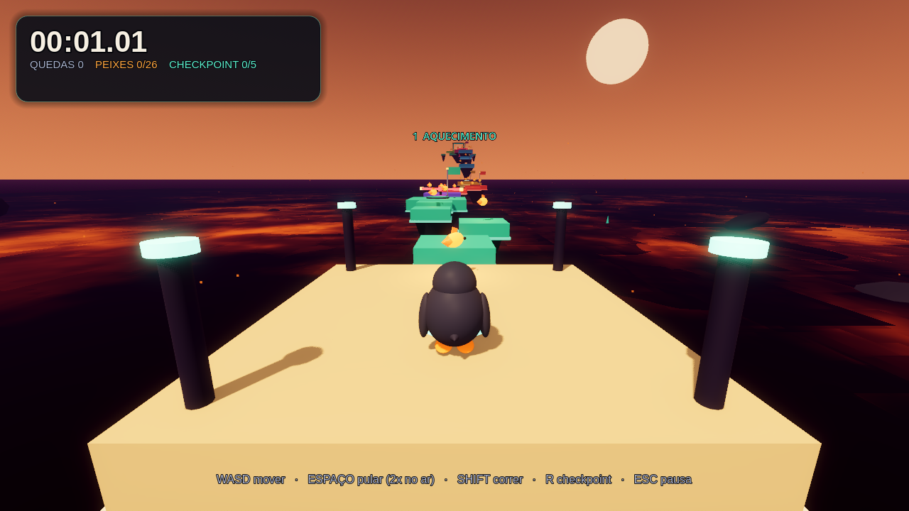
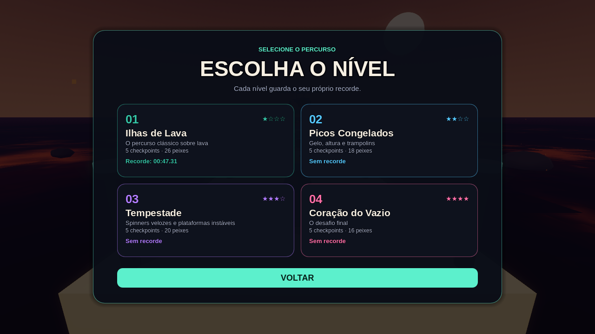
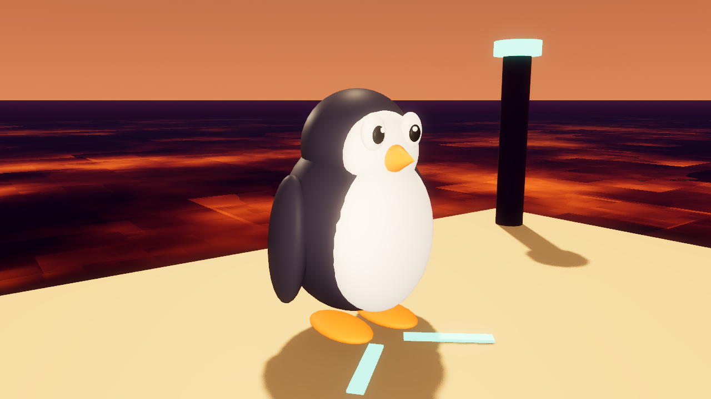

# Tux Obby 3D

[](LICENSE)
[](https://godotengine.org)

Um obby/parkour 3D feito em **Godot 4.7** estrelado pelo **Tux**, o pinguim do Linux.
Atravesse quatro percursos flutuantes sobre o vazio, desvie de obstáculos
giratórios, suba de trampolim e colete os peixinhos espalhados pelo caminho.

O jogo está disponível em **português (Brasil), inglês e espanhol**. Escolha o
idioma e o nível no menu inicial; as duas preferências ficam salvas entre
partidas. Cada nível tem checkpoints, peixinhos e recorde próprios.

Tudo no jogo é gerado em tempo de execução com primitivas 3D: não há modelos,
texturas ou músicas externas. Cada percurso tem um tema visual: ilhas de lava,
picos congelados, tempestade e o coração do vazio. O cenário de fundo mantém um
pôr do sol alaranjado, com planetas, partículas e ilhas distantes.







## Como rodar

Requer **Godot 4.7 ou mais novo** (Forward+).

```bash
# direto pelo terminal
godot --path /caminho/para/tux-obby

# ou use o atalho do projeto (Godot precisa estar no PATH)
./run.sh

# ou abra o Godot, clique em "Importar" e selecione project.godot
```

O jogo abre no menu inicial. Escolha o idioma no seletor **IDIOMA / LANGUAGE**,
abra **NÍVEIS** para escolher o percurso e clique em **JOGAR** ou aperte **ENTER**.
O menu de níveis também pode ser aberto pela pausa ou pela tela de vitória.

### Baixar o executável

Baixe o binário Linux mais recente em
[**Releases**](https://github.com/ericnix/tux-obby-3d/releases/latest).
Ele é autocontido (PCK embutido) e não precisa do Godot instalado:

```bash
chmod +x tux-obby.x86_64
./tux-obby.x86_64
```

Se você exportou o projeto localmente, o binário também fica em
`build/tux-obby.x86_64` (a pasta `build/` não é versionada no Git).

### Exportar novamente

Instale os templates oficiais do **Godot 4.7.2** pelo editor
(**Editor → Gerenciar Templates de Exportação**). O preset **Linux** está em
`export_presets.cfg`. Para regerar o binário:

```bash
godot --headless --path . --export-release "Linux" build/tux-obby.x86_64
```

### Controles

| Tecla | Ação |
| --- | --- |
| `W A S D` / setas | mover o Tux |
| mouse | girar a câmera |
| `ESPAÇO` | pular (aperte de novo no ar para o pulo duplo) |
| `SHIFT` | correr |
| `R` | voltar ao último checkpoint |
| `ESC` | pausar / continuar |
| `Q` | sair (na pausa ou na tela de vitória) |

## Objetivo

- Escolher um dos **4 níveis** no menu **NÍVEIS** e entrar no portal **META**.
- Passar pelos **5 checkpoints** de cada nível: ao encostar na bandeira, ela vira
  o novo ponto de renascimento.
- Coletar os peixinhos de cada percurso. Eles ficam escondidos em plataformas
  móveis, passagens altas e cantos do cenário.
- Terminar no menor tempo possível. Cada nível guarda o seu próprio recorde em
  `user://tux_obby.cfg` (na pasta de dados do usuário do Godot).
- O idioma e o nível escolhidos ficam salvos em `user://tux_obby_settings.cfg`.

Cair no vazio conta uma queda e devolve o Tux ao último checkpoint. O cronômetro
pausa durante a animação de respawn.

## Níveis

| Nº | Nome | Tema | Desafio | Checkpoints | Peixes |
| --- | --- | --- | --- | --- | --- |
| 1 | Ilhas de Lava | lava alaranjada | percurso clássico com balsas, trampolim e discos | 5 | 26 |
| 2 | Picos Congelados | gelo azul e neve | subida com gelo que desaparece, trampolins e elevadores | 5 | 18 |
| 3 | Tempestade | roxo e relâmpagos | spinners rápidos, balsas e plataformas instáveis | 5 | 20 |
| 4 | Coração do Vazio | rosa neon e fragmentos | saltos curtos, plataformas giratórias e elevadores | 5 | 16 |

Cada nível tem 5 checkpoints, vários trechos e um portal de chegada. O nível 1
mantém o percurso original; os níveis 2 a 4 foram construídos com a mesma
gramática de movimento, mas com layouts, paletas e obstáculos próprios.

## Estrutura do projeto

```
project.godot              configuração, inputs e autoload de áudio
export_presets.cfg         preset de exportação Linux (x86_64, PCK embutido)
LICENSE                    licença MIT do projeto
THIRD_PARTY_NOTICES.md     Godot, Liberation Sans, Tux e áudio
scenes/
  main.tscn                cenário, sol, jogador e HUD
  player.tscn              CharacterBody3D + modelo do Tux + câmera
scripts/
  main.gd                  estado da partida, timer, mortes, pausa, vitória, save
  level_catalog.gd         metadados dos 4 níveis (nome, tema, peixes, recorde)
  level.gd                 construção dos 4 percursos e do cenário
  player.gd                movimento, coyote time, buffer de pulo, pulo duplo
  tux_model.gd             Tux procedural + animações (andar, piscar, pulo duplo)
  camera_rig.gd            câmera orbital em terceira pessoa com colisão
  hud.gd                   HUD, menu, seleção de nível, pausa e vitória
  loc.gd                   textos em pt-BR, inglês e espanhol + preferência salva
  sfx.gd                   pool de efeitos + trilha em loop (autoload)
  obstacle_kit.gd          utilitários de geometria e materiais
  obstacles/               checkpoint, peixe, trampolim, portais, spinners,
                           plataformas móveis/giratórias/que desaparecem
assets/
  audio/                   WAVs gerados por tools/generate_audio.py
  fonts/                   Liberation Sans (SIL OFL, ver LICENSE.txt)
docs/                      capturas usadas no README
tools/
  generate_audio.py        regenera todos os sons e a música (requer numpy)
  capture.gd / .tscn       capturas de tela para inspeção visual
  test_game.gd / .tscn     teste automatizado de jogabilidade
```

`build/` e `.godot/` ficam fora do Git. O binário pronto é distribuído em
[Releases](https://github.com/ericnix/tux-obby-3d/releases/latest).

## Testes

Teste automatizado (158 verificações: movimento, pulo duplo, morte/respawn,
checkpoints, peixes, pausa, trampolim, plataformas, áudio, vitória, os quatro
níveis, o menu de níveis e os três idiomas):

```bash
godot --headless --path . --scene res://tools/test_game.tscn --audio-driver Dummy
```

O teste restaura o arquivo de recordes e a preferência de idioma originais ao
terminar, para não gravar dados falsos.

Capturas de tela do jogo (salvas em `/tmp/opencode/tux_shots/` por padrão):

```bash
godot --path . --scene res://tools/capture.tscn --audio-driver Dummy \
  --resolution 1280x720
```

## Áudio

Todos os efeitos e a trilha são sintetizados por `tools/generate_audio.py`
(senoides, triângulos, quadradas, ruído e sinos). Para regerar:

```bash
python3 tools/generate_audio.py
```

## Licença

O código e o conteúdo original deste projeto estão sob a **licença MIT** —
veja [LICENSE](LICENSE).

- **Godot Engine 4.7** — MIT. O texto está em
  [THIRD_PARTY_NOTICES.md](THIRD_PARTY_NOTICES.md).
- **Liberation Sans** — SIL Open Font License 1.1; texto completo em
  [assets/fonts/LICENSE.txt](assets/fonts/LICENSE.txt).
- **Tux** — criado por Larry Ewing; créditos e aviso de permissão em
  [THIRD_PARTY_NOTICES.md](THIRD_PARTY_NOTICES.md).
- **Áudio** — sintetizado por `tools/generate_audio.py` para este projeto.

## Créditos

- Tux é o mascote oficial do Linux, criado por Larry Ewing.
- Fonte Liberation Sans, distribuída sob a SIL Open Font License.
- Feito com Godot Engine 4.7.
